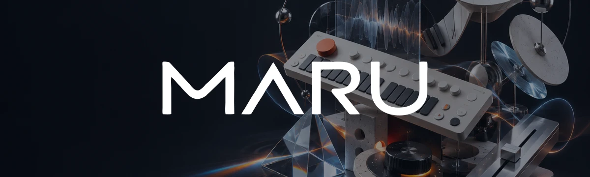

# Maru



**Turn musical ideas into instruments, effects and sounds you can use and share.**

[Maru](https://maru.audio) brings together tools for making audio products,
working with musical ideas and creating sound collections. Build an instrument
around your own way of playing, shape an effect for a particular sound, or turn
a collection of recordings into a playable kit.

You can direct the work through your agent, edit the project yourself, or
combine both. Your work stays in an editable project that you can develop
further and prepare for supported browser and plugin formats.

## Bring Maru to your agent

The Maru skill connects the agent you already use to this ecosystem. It helps
the agent choose the right tools, work with your project and check the result.
Works with Claude Code, Codex, Cursor and other coding agents.

Start at [Connect Maru](https://maru.audio/mcp) to set up the skills and MCP
servers for your coding agent. For the entry skill alone:

```sh
npx maruaudio skill install
```

Then describe what you want to make:

- “Make a tape effect that gets darker as the repeats fade.”
- “Create a chord tool with voicings I can play from my keyboard.”
- “Turn these percussion recordings into a drum kit.”
- “Help me finish this instrument and prepare a plugin release.”
- “List my plugin on the Maru marketplace.”

### As a plugin

This repository is also a plugin for Claude Code and Codex. One install adds
the skills and Maru's MCP servers.

**Claude Code**

```sh
claude plugin marketplace add maru-audio/maru-skill
claude plugin install maru@maru-audio
```

Then run `/mcp`, choose **maru** and **Authenticate**.

**Codex**

```sh
codex plugin marketplace add maru-audio/maru-skill
codex plugin add maru@maru-audio
```

Then run `codex mcp login maru`. In the ChatGPT desktop app you can also
install it from **Plugins** once the marketplace is added.

| Part | What it does |
| --- | --- |
| `maru-agent` skill | The same skill as above |
| `new-synth` skill | Starts a synth from a template, in your account or in a folder |
| `find-module` skill | Finds a community module, explains its source and forks it with your OK |
| `check-build` skill | Reports your plug-in builds and why the latest one failed |
| `list-on-marketplace` skill | Lists your plug-in on the Maru marketplace, built with any framework: listing, media, offer and release, confirmed with you before it goes to review |
| `create-module` skill | Starts an instrument, effect or other module from your brief and clarifies missing consequential choices |
| `add-parameter` skill | Adds one control through the schema, the sound, the face and presets, and measures that it works |
| `verify-module` skill | Checks a module with Maru's release checks, offline renders, a face screenshot and native builds, and reports any gaps |
| `debug-toolchain` skill | Finds why a command, sign-in, MCP server, build or workbench is not working, and fixes the cause |
| `build-for-hardware` skill | Guides module device builds, native firmware forks and controller apps using the exact device and installed tools; separates mocks, physical tests, publication and installation |
| `list-plugin` skill | Chooses with you how a plug-in goes on Maru and confirms its name, price and licence before review |
| `maru` server | The hosted connector at `https://maru.audio/mcp`: your Maru account, after you sign in to Maru and approve the connection in your browser |
| `maru-local` server | Runs the published `maruaudio` package from npm on your computer (`npx maruaudio mcp`, pinned to a published release) for the module project in your folder |

Ask in your own words, or pick a skill yourself: type `/maru:new-synth` in
Claude Code, or type `@` in Codex and choose Maru.

`maru-agent` is the entry point and hands each of these jobs to its workflow
skill. `npx maruaudio skill install` installs `maru-agent` alone; an agent
without the plugin reads a workflow skill from `skills/<name>/SKILL.md` in
this repository. Each skill ends a reply with a `MARU FEEDBACK` line when
Maru made part of the job harder than it should; you can send it to Maru as
an [issue](https://github.com/maru-audio/maru-skill/issues).

The hosted server talks only to maru.audio, as the account you approve. The
local server runs Maru's command-line operations on your folder; the ones
that need your account, such as audio jobs, reach maru.audio after
`maru login`. See the [privacy policy](https://maru.audio/privacy). If you already added Maru,
check the existing server scopes before installing another copy. Keep the working
connection and resolve conflicting entries without exposing or replacing its credentials.

In Claude, ChatGPT and other chat apps, add the hosted connector instead:
[connect your agent](https://maru.audio/docs/mcp-connect).

## One connected ecosystem

**Studio** is Maru's project workspace. The **Engine** provides the foundation
for instruments, effects and musical tools. **Symbolic** works with notes,
chords, scales and rhythms. Maru's sound tools support generation, samples and
sampler banks.

The skill brings these capabilities into your agent's workflow. You bring the
musical direction; Maru provides tools to develop it into something playable.

[Explore Maru](https://maru.audio) ·
[Studio](https://maru.audio/studio-builder) ·
[Engine](https://maru.audio/engine) ·
[Symbolic](https://maru.audio/symbolic)

## Getting started and documentation

Read [Maru skills](https://maru.audio/docs/skills) for setup, how to use the
skill, example workflows and connecting your Maru account. The
[documentation](https://maru.audio/docs) covers the platform and its tools.

[Contact](https://maru.audio/contact) ·
[Report an issue](https://github.com/maru-audio/maru-skill/issues) ·
[MIT license](./LICENSE)
